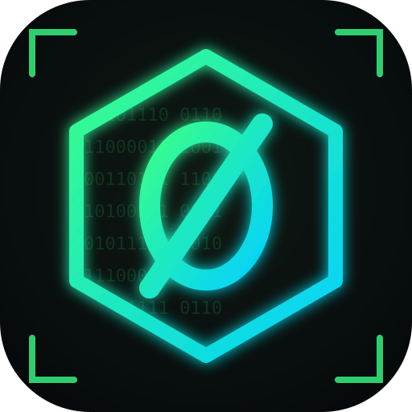

  

<h1 align="center">NullCipher</h1>

  <b>Equipo de ciberseguridad · Seguridad Informática · URU</b> 
  Criptografía aplicada, transporte seguro y almacenamiento cifrado.

  
  
  
  

---

### 🛡️ Proyectos

| Proyecto | Descripción | Stack |
|---|---|---|
| [**YouBeam**](https://github.com/nullcipher-sec/Youbeam) | Plataforma de streaming de video con transmisión cifrada por UDP (WebRTC DTLS-SRTP), almacenamiento cifrado con HPKE en un bucket MinIO y autorización con tickets JWT ES256. | React · Spring Boot · Go (Pion) · PostgreSQL · MinIO · Docker |

### 👥 Equipo

| | Integrante | Área |
|---|---|---|
|  | [@marcelopcx](https://github.com/marcelopcx) | Backend y almacenamiento cifrado |
|  | [@arrias24](https://github.com/arrias24) | Frontend |
|  | [@luiscab19](https://github.com/luiscab19) | Streaming seguro |
|  | [@JhonmarMorales17](https://github.com/JhonmarMorales17) | Infraestructura |

### ⚙️ Cómo trabajamos

- Cada integrante desarrolla en su rama `dev/<usuario>`.
- Todo cambio entra a `main` mediante Pull Request.
- Las tareas de cada área están en los [issues de YouBeam](https://github.com/nullcipher-sec/Youbeam/issues).
- Ninguna clave privada ni archivo `.env` se sube a los repositorios.
